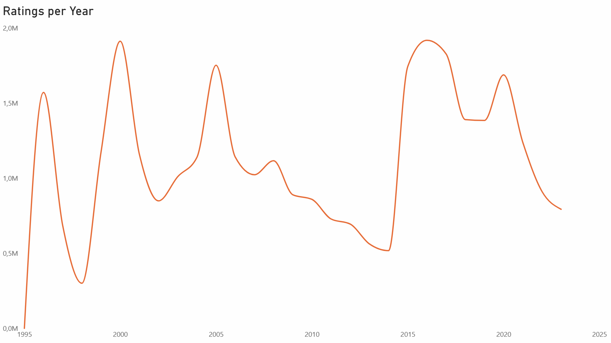
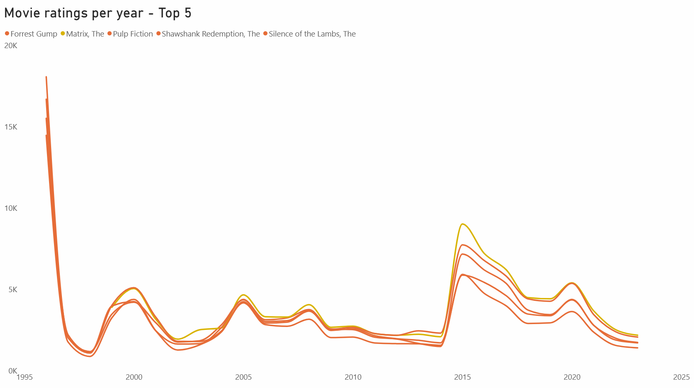

# ETL - Transformation Steps
## movies
- Split 'title' by paratheses to get 'year'

## ratings
- convert 'rating' to int
- convert 'timestamp' from unix to date/string type 

## Willhelm Scream

- For imdbId column, remove first 2 characters in order to join with movies table

# Potential storylines/features

## Volume and Average of Ratings per Year
This is interesting in order to check the number of ratings in other years vs it's year of release. Some movies might get more popular in later years.

### Results verified

**Volume**  
The disitribution of ratings per year seems to be biased. What is expected is a constant evolution of ratings without much variation between years, so there's a chance there's an external factor coming into play in this data. Eg: Data imports performed on the following years: 1996 (First year of data), 2000, 2005, 2015, 2016

  

We can verify the same happens for the top 5 films with most ratings, verifying that performing an analysis in terms of volume is irrelevant

Popular and well-rated are different things.

Independence Day, 3.39 rating, and Batman (1989), 3.43 rating, have had over 50k ratings each across 28 years. They are the lowest-rated of the heavily rated films, and still very popular.

Jurassic Park, Aladdin, Shrek, The Lion King and Toy Story all sit around 3.7-3.9, which is good but well below the top group.