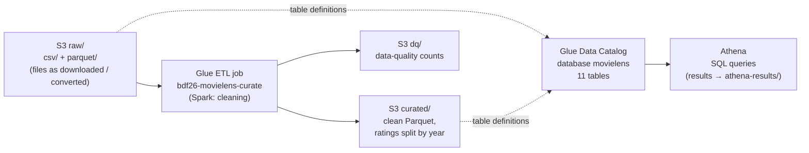

# AWS setup guide — rebuild it yourself, and understand what it does

*Paulo · branch `paulo_aws` · 24 Nov 2026*

This guide has two jobs:

1. **Rebuild** the AWS side of the project in your own AWS Academy Learner Lab, using only the AWS web console (no command line, no scripts, no credentials files).
2. **Explain** what each piece is, why it was built that way, and what the numbers mean, so you can talk about it in the presentation and Q&A.

The short results summary is in [PROGRESS.md](PROGRESS.md). My working notes from each step are in [notes/](notes/), explained in [section 6](#6-the-working-notes-in-notes).

---

## Contents

1. [The big picture](#1-the-big-picture)
2. [Concepts you need](#2-concepts-you-need)
3. [Before you start](#3-before-you-start)
4. [Rebuild step by step](#4-rebuild-step-by-step)
   - [Step A — Create the S3 bucket and upload the raw files](#step-a--create-the-s3-bucket-and-upload-the-raw-files)
   - [Step B — Set up Athena](#step-b--set-up-athena)
   - [Step C — Create the database and the raw tables](#step-c--create-the-database-and-the-raw-tables)
   - [Step D — Check the raw tables](#step-d--check-the-raw-tables)
   - [Step E — Create and run the Glue ETL job](#step-e--create-and-run-the-glue-etl-job)
   - [Step F — Create the curated tables](#step-f--create-the-curated-tables)
   - [Step G — Check the curated tables](#step-g--check-the-curated-tables)
5. [Why it was built this way](#5-why-it-was-built-this-way)
6. [The working notes in notes/](#6-the-working-notes-in-notes)
7. [Troubleshooting](#7-troubleshooting)
8. [Glossary](#8-glossary)

---

## 1. The big picture

Locally, Henrique's pipeline is: CSV files → `convert_csv_to_parquet.py` → Parquet files → DuckDB queries. The AWS side does the **same job with cloud services**, so we can compare the two (that comparison is 40% of the grade).



Each AWS piece has a local twin (this is the course's week 1 "dual stack" table):

| Layer | Local | AWS | In this project |
|---|---|---|---|
| Storage | files on disk | **S3** | bucket `bdf26-movielens-XXXX` |
| File format | Parquet | Parquet | `raw/parquet/`, `curated/` |
| Catalog (which tables exist, columns, where the files are) | DuckDB views / temp tables | **Glue Data Catalog** | database `movielens` |
| Query engine | DuckDB | **Athena** | the SQL in `aws/athena/` |
| Cleaning (Henrique's "support tables") | SQL in `movie_lens_analysis_queries.sql` | **Glue ETL job** (Spark) | `aws/glue/movielens_curate.py` |

There are three "zones" in the bucket, a common data-lake pattern:

- **raw/**: the data exactly as we got it. Never changed, so we can always start over.
- **curated/**: cleaned data, ready for analysis. Rebuilt by the Glue job whenever we want.
- **dq/**: the data-quality report the job writes each time it runs.

---

## 2. Concepts you need

You can follow the steps without reading this, but you'll want it for Q&A.

**S3 (Simple Storage Service).** Storage for files ("objects") in a "bucket". There are no real folders: a file called `raw/csv/movies/movies.csv` just has a name with slashes in it, and the console shows the slashes as folders. Those name prefixes matter, because every table points at one prefix and reads every file under it. That's why each table has its own folder, even with only one file in it.

**External table and schema-on-read (week 3).** A table in Athena is only a definition: column names and types, a file format, and an S3 location. The data stays in S3 as plain files. Athena applies the structure when it reads the files (schema-on-read). Dropping an external table deletes only the definition; the files stay. It's the same idea as `CREATE VIEW ... AS SELECT * FROM read_parquet(...)` in DuckDB.

**Glue Data Catalog.** The list of databases and table definitions that Athena reads. It's AWS's version of the Hive Metastore from week 3. When you run `CREATE EXTERNAL TABLE` in Athena, the definition is saved in the Glue Data Catalog, so you'll see the same tables in the Glue console under Data Catalog → Tables.

**Athena.** A serverless SQL engine (based on Trino/Presto, week 3). There's no server to start: you write SQL and it runs. You pay **$5 per TB of data it reads from S3** ("data scanned"), with a 10 MB minimum per query. That's why the file format matters so much for cost.

**CSV vs Parquet.** CSV is text, one row per line, so to read one column you must read every line in full. Parquet is binary and **columnar**: each column is stored separately and compressed. A query that needs two columns reads only those two. Parquet also stores row counts and min/max values in the file's footer, so some queries need almost no reading at all.

**Partitioning.** Splitting a table into folders by a column's value, e.g. `curated/ratings/rating_year=2015/`. A query with `WHERE rating_year = 2015` then reads only that folder (partition pruning). Our ratings are split into 29 year folders, 1995 to 2023.

**Glue ETL job.** A Python script that runs on Apache Spark, on machines AWS starts for the job and shuts down after. You pay per **DPU-hour** (a DPU is 4 vCPUs and 16 GB of memory) at $0.44, with a 1-minute minimum. Our job uses 2 workers of 1 DPU each for about 3 minutes, about $0.05.

**Learner Lab and LabRole.** The Learner Lab is a real AWS account with restrictions: only the us-east-1 and us-west-2 regions, and you can't create IAM users or roles. Services like Glue need a role to act on your behalf (read S3, write logs), so we use the role the lab already provides, **LabRole**. Your files and tables stay between lab sessions; only the session itself ends when the timer runs out.

---

## 3. Before you start

You need:

- **The AWS Academy Learner Lab** for this course, started (green dot next to "AWS"). Click "AWS" to open the console.
- **Region us-east-1 (N. Virginia).** Check the region name in the top right of the console on every page. Anything created in another region won't be visible from us-east-1, and most regions are blocked in the lab.
- **The MovieLens 32M files on your computer:** `ratings.csv`, `movies.csv`, `tags.csv`, `links.csv` (team Google Drive, or grouplens.org/datasets/movielens/32m).
- **The Parquet versions** of those four files. Run Henrique's script from the repo root (see the README for the `.venv` setup):
  ```
  python convert_csv_to_parquet.py
  ```
  This creates `data/parquet/ratings.parquet`, `movies.parquet`, `tags.parquet` and `links.parquet`. The Glue job reads these, so you need them.
- **This repo** open somewhere you can copy text from: you'll paste the SQL from `aws/athena/` and the script from `aws/glue/` into the console.

**Choose your bucket name now.** Bucket names are global across all of AWS, so you can't reuse mine. I used `bdf26-movielens-6339` (the last 4 digits of my account ID). Use something like `bdf26-movielens-<your initials>-<4 digits>`, lowercase, no spaces. **Wherever this guide or the SQL files say `bdf26-movielens-6339`, put your bucket name instead.**

**Cost:** the whole rebuild uses well under $1 of lab credit. Uploading is free; the Glue run is about $0.05; each Athena query is a fraction of a cent.

---

## 4. Rebuild step by step

### Step A — Create the S3 bucket and upload the raw files

*What this does:* creates the storage and puts the original data in the raw zone.

1. In the console search bar, type **S3** and open it.
2. Click **Create bucket**.
   - Bucket type: **General purpose**.
   - Bucket name: your name from section 3.
   - Region: **US East (N. Virginia) us-east-1**.
   - Leave **Block all public access** ticked. Nobody outside your account needs to read it.
   - Leave everything else as it is and click **Create bucket**.
3. Open the bucket and create this folder structure with **Create folder** (create `raw`, open it, create `csv` and `parquet`, and so on):
   ```
   raw/csv/ratings/
   raw/csv/movies/
   raw/csv/tags/
   raw/csv/links/
   raw/parquet/ratings/
   raw/parquet/movies/
   raw/parquet/tags/
   raw/parquet/links/
   athena-results/
   ```
   You don't need to create `curated/`, `dq/`, `scripts/` or `glue-temp/`; they appear later on their own.
4. Upload each file into **its own folder**: open the folder, click **Upload → Add files**, pick the file, click **Upload**.
   - `ratings.csv` → `raw/csv/ratings/`, `movies.csv` → `raw/csv/movies/`, and so on.
   - `ratings.parquet` → `raw/parquet/ratings/`, and so on.
   - `ratings.csv` is 836 MB, so that upload takes a few minutes. Keep the tab open until it says "Upload succeeded".
5. **Check:** you should have 8 files. The sizes should be about: ratings 836 MB / 209 MB, tags 69 / 20 MB, movies 4.0 / 2.1 MB, links 1.9 / 1.3 MB (CSV / Parquet).

> **Why one folder per table?** An Athena table points at a folder and reads every file in it. If `movies.csv` and `ratings.csv` were in the same folder, the movies table would also try to read the ratings file.

### Step B — Set up Athena

*What this does:* tells Athena where to save query results. Athena always writes each result to S3 as a CSV, even for queries you only look at on screen.

1. Search for **Athena** and open it. If you see a landing page, click **Launch query editor**.
2. Go to the **Settings** tab (at the top of the query editor) → **Manage**.
3. **Location of query result:** `s3://<your-bucket>/athena-results/` (with the trailing slash). Click **Save**.
4. Back in the **Editor** tab, check that on the left **Data source** is `AwsDataCatalog`.

> I set the result location per query from a script instead, because my account still has settings from earlier class labs. In a clean account, setting it here is simpler and does the same thing.

**How to run SQL in the Athena editor (you'll do this a lot):**
- Paste SQL into the editor box and click **Run** (or Ctrl+Enter).
- **Athena runs one statement at a time.** Our `.sql` files have several statements separated by `;`. Either paste and run them one by one, or paste the whole file, select one statement with the mouse and click **Run** (it runs only the selection).
- Under the results, **Run time** and **Data scanned** are shown for every query. Those two numbers are the evidence for the presentation, so note them when they matter.
- The lines starting with `--` are comments, and Athena ignores them.

### Step C — Create the database and the raw tables

*What this does:* creates the catalog entries that turn the folders from Step A into tables. No data moves; Athena only records where the files are and how to read them.

1. **Database.** Paste and run the statement from [`aws/athena/ddl/00_database.sql`](../../aws/athena/ddl/00_database.sql):
   ```sql
   CREATE DATABASE IF NOT EXISTS movielens
   COMMENT 'BDF MovieLens 32M project tables';
   ```
   Then refresh the **Database** dropdown on the left and choose `movielens`.

2. **Raw CSV tables.** Open [`aws/athena/ddl/01_raw_csv.sql`](../../aws/athena/ddl/01_raw_csv.sql). It has 4 statements (`ratings_csv`, `movies_csv`, `tags_csv`, `links_csv`). **Replace `bdf26-movielens-6339` with your bucket** in each `LOCATION` line, then run them one at a time. Example:
   ```sql
   CREATE EXTERNAL TABLE IF NOT EXISTS movielens.movies_csv (
     movieId BIGINT,
     title   STRING,
     genres  STRING
   )
   ROW FORMAT SERDE 'org.apache.hadoop.hive.serde2.OpenCSVSerde'
   WITH SERDEPROPERTIES ('separatorChar' = ',', 'quoteChar' = '"', 'escapeChar' = '\\')
   STORED AS TEXTFILE
   LOCATION 's3://<your-bucket>/raw/csv/movies/'
   TBLPROPERTIES ('skip.header.line.count' = '1');
   ```
   What each part means:
   - `CREATE EXTERNAL TABLE`: only the definition is stored; the data stays in S3.
   - The column list must follow the CSV's column order.
   - `OpenCSVSerde` is the reader ("SerDe" = serializer/deserializer) that understands quoted text. Some movie titles and tags contain commas inside quotes (`"American President, The (1995)"`); a simple comma splitter would break those rows into extra columns.
   - `skip.header.line.count = 1` skips the header row (`movieId,title,genres`), which would otherwise become a data row.
   - `LOCATION` is the folder, not the file.
   - In `links_csv`, `imdbId` and `tmdbId` are `STRING` on purpose: imdbIds have leading zeros (`0114709`) that a number type would drop, and 124 rows have an empty `tmdbId`.
   - `timestamp` is a reserved word in SQL, so in these table definitions it's written with backticks: `` `timestamp` ``.

3. **Raw Parquet tables.** Same thing with [`aws/athena/ddl/02_raw_parquet.sql`](../../aws/athena/ddl/02_raw_parquet.sql): replace the bucket name, then run the 4 statements one by one. These are simpler (`STORED AS PARQUET`, no SerDe or header settings), because Parquet files carry their own column types. The types in the SQL must match what's in the files; they were checked against DuckDB's `DESCRIBE` of the local Parquet files.

4. **Check:** the left panel under **Tables** should now list 8 tables. You can also see them in the **Glue** console → **Data Catalog → Databases → movielens**, which shows that Athena and Glue share one catalog.

### Step D — Check the raw tables

*What this does:* proves the tables read the files correctly, by comparing with the numbers DuckDB gives locally.

1. Run each statement in [`aws/athena/checks/01_row_counts.sql`](../../aws/athena/checks/01_row_counts.sql). Expected:

   | Table | Rows |
   |---|---:|
   | ratings_csv / ratings_parquet | 32,000,204 |
   | movies_csv / movies_parquet | 87,585 |
   | tags_csv / tags_parquet | 2,000,072 |
   | links_csv / links_parquet | 87,585 |

   Look at **Data scanned**: about 836 MB for `ratings_csv`, but **0 KB for `ratings_parquet`**. Athena counts Parquet rows from the file footer without reading the data. (It still bills the 10 MB minimum.)

2. Run the statements in [`aws/athena/checks/02_sanity.sql`](../../aws/athena/checks/02_sanity.sql). Both ratings tables should give `avg_rating` 3.5403956487277393, `min_ts` 789652004 and `max_ts` 1697164147. `links_csv` should show 124 empty tmdbIds and 46,596 imdbIds with a leading zero.

   This is the first real CSV vs Parquet comparison: the same query scans **~836 MB on CSV and ~136 MB on Parquet**, because Parquet only reads the `rating` and `timestamp` columns.

   Note that in queries `timestamp` is written with **double quotes**: `"timestamp"`. Backticks only work in `CREATE TABLE` statements, and a query with backticks fails with `MALFORMED_QUERY`. (Table definitions use Hive syntax, queries use Trino syntax.)

If a count is 0 or wildly off, see [Troubleshooting](#7-troubleshooting).

### Step E — Create and run the Glue ETL job

*What this does:* cleans the data (Henrique's `t_movies` and `t_ratings` support tables, plus links), and writes it as Parquet to `curated/`, with ratings split into one folder per year. Section 5 explains each cleaning decision.

1. Search for **AWS Glue** and open it. In the left menu, under **Data Integration and ETL**, click **ETL jobs**.
2. Under **Create job**, choose **Script editor**. Engine: **Spark**. Options: **Start fresh**. Click **Create script**.
3. Delete the sample code and paste the whole of [`aws/glue/movielens_curate.py`](../../aws/glue/movielens_curate.py). **Don't edit the bucket name in the script**: it comes from a job parameter (point 5).
4. At the top, rename the job (click "Untitled job") to `bdf26-movielens-curate`.
5. Open the **Job details** tab and set:

   | Field | Value | Why |
   |---|---|---|
   | IAM Role | **LabRole** | the only role the lab allows; it can read and write your bucket |
   | Type | Spark | the script uses PySpark |
   | Glue version | **Glue 5.0** (4.0 also works) | |
   | Language | Python 3 | |
   | Worker type | **G.1X** | 1 DPU per worker, the smallest Spark worker |
   | Requested number of workers | **2** | the minimum; the data is small enough |
   | Job timeout (minutes) | 30 | safety net; a normal run takes about 3 minutes |
   | Number of retries | 0 | a failed run should stop, not quietly run again |

   Then open **Advanced properties**:
   - **Script path:** `s3://<your-bucket>/scripts/glue/`
   - **Temporary path:** `s3://<your-bucket>/glue-temp/`
   - **Job parameters → Add new parameter:** Key `--BUCKET` (two dashes), Value `<your-bucket>` (just the name, no `s3://`).
6. Click **Save**, then **Run**.
7. Open the **Runs** tab. The status goes from Starting → Running → **Succeeded** in about 3–4 minutes. The run shows the execution time (mine was 190 s) and the DPU usage.
   - If it fails, the error message is shown in the run details. For the full log, the run has links to **CloudWatch** output and error logs.
8. **Check in S3** that the job wrote:
   - `curated/movies/` and `curated/links/`: one Parquet file each.
   - `curated/ratings/`: **29 folders** named `rating_year=1995` to `rating_year=2023`, each with one Parquet file.
   - `dq/movielens_curate/`: one CSV file. Download it and open it: it's the data-quality report (rows in/out, nulls, duplicates, ratings per year). Compare it with [results/dq_movielens_curate.csv](results/dq_movielens_curate.csv).

> **What the script does, in order** (the comments in the script say the same):
> 1. Sets the time zone to UTC, so dates from unix timestamps don't depend on where the machines run.
> 2. **Movies:** reads `raw/parquet/movies/`, splits the year from the end of the title with a regular expression, keeps titles without a year whole, writes `curated/movies/`.
> 3. **Ratings:** reads `raw/parquet/ratings/`, keeps the rating as a decimal (half stars), turns the timestamp into a date (`dateOfRating`) and a year (`rating_year`), and writes one folder per year to `curated/ratings/`.
> 4. **Links:** keeps `imdbId` as text and adds `imdb_tt` (`tt` + imdbId, the format IMDb uses in its URLs, for the Wilhelm scream join later), writes `curated/links/`.
> 5. Counts rows in and out, nulls, out-of-range ratings, duplicates, ratings without a movie, and ratings per year, and writes them to `dq/`.

### Step F — Create the curated tables

*What this does:* registers the job's output in the catalog, the same way as Step C.

1. Open [`aws/athena/ddl/03_curated.sql`](../../aws/athena/ddl/03_curated.sql), replace the bucket name, and run its 4 statements one by one in Athena:
   - `movies_curated` and `links_curated`: plain Parquet tables.
   - `ratings_curated`: a Parquet table with `PARTITIONED BY (rating_year INT)`. Note that `rating_year` is **not** in the column list: it comes from the folder names (`rating_year=2015`), not from inside the files.
   - `MSCK REPAIR TABLE movielens.ratings_curated;` scans the table's folder and registers each `rating_year=...` folder as a partition. **Without this the table looks empty**, because Athena only reads partitions it knows about.
2. If you ever rerun the Glue job, the files are replaced, but the table definitions stay; run `MSCK REPAIR TABLE` again only if new years appear.

### Step G — Check the curated tables

Run the statements in [`aws/athena/checks/03_curated_checks.sql`](../../aws/athena/checks/03_curated_checks.sql). Expected:

| Check | Expected |
|---|---|
| ratings_curated rows | 32,000,204 |
| movies_curated rows | 87,585 |
| links_curated rows | 87,585 |
| partitions | 29, from 1995 to 2023 |
| avg / min / max rating | 3.5403956487277393 / 0.5 / 5.0 (same as raw: half stars kept) |
| movies with no yearOfRelease | 615 |
| ratings per year | same as [results/rows_per_year.csv](results/rows_per_year.csv) |

Note **Data scanned** on the average-rating query: about **14 MB**, against ~136 MB on the raw Parquet table and ~836 MB on CSV. That's the end-to-end effect of the curated layout (see section 5 for why it isn't only the file format).

**That's the whole setup.** You now have the same 11 tables as me: 4 raw CSV, 4 raw Parquet, 3 curated.

---

## 5. Why it was built this way

**Keep raw files untouched; clean into a separate zone.** If a cleaning rule turns out to be wrong, we fix the script and rerun it; the original data is still in `raw/`. This is the raw/curated pattern from the course's data-lake material (Uber's platform keeps raw and processed data separately for the same reason).

**Raw tables in both CSV and Parquet.** Having the same data in both formats, side by side, is what lets us measure the format's effect in Athena (Step 6 of the plan). The CSV tables also prove the cloud side can start from the files exactly as downloaded.

**Table definitions written in SQL, not with a Glue crawler.** A crawler guesses the schema by sampling the files. Writing the `CREATE TABLE` statements ourselves means the types are exactly what we decided (imdbId as text, for instance), and the definitions are in the repo, so anyone can recreate them.

**Glue reads the Parquet files, not the CSVs.** Parquet is smaller and already typed, so the job reads less and doesn't have to parse text.

**The cleaning decisions, compared with the local SQL** (details in [PROGRESS.md](PROGRESS.md), "Findings for Henrique"):

| Local (`movie_lens_analysis_queries.sql`) | Glue job | Why |
|---|---|---|
| `TRY_CAST(rating AS INTEGER)`: 3.5 → 4, 2.5 → 2, 0.5 → **0** | rating stays `DOUBLE` | 31% of ratings are half stars; rounding changes averages per film, and 0 is off the 0.5–5 scale. The overall average is identical to the raw data (3.5404). |
| Title: always cut the last 7 characters | remove `(yyyy)` only if it's really there | Locally, titles without a year are damaged ("Terrible Joe Moran" → "Terrible Jo"). |
| Year: last 5 characters, cast to number | first 4-digit year inside the brackets at the end | Locally, titles ending in digits get impossible years (201, −200). Ranges like `(2006–2007)` give the first year. 615 movies end up with no year (613 locally, explained in [notes/step4_etl_numbers.md](notes/step4_etl_numbers.md)). |
| date from timestamp in the computer's time zone | date in **UTC** | Same result on every machine. (For this data, Lisbon time and UTC give identical years.) |

**Ratings partitioned by year.** Most of the storylines look at ratings over time. With one folder per year, a query about one year or a range of years only reads those folders. The job also writes **one file per year** (`repartition("rating_year")`); without that, Spark writes many small files per folder, and many small files make Athena slower.

**Why curated ratings are so much smaller (90 MB vs 209 MB) and cheaper to scan.** Two things besides the format: the 10-digit timestamp became a date, which compresses far better, and grouping rows by year puts similar values next to each other, which also compresses better. So the CSV → raw Parquet numbers (836 → 136 MB scanned) show the **format effect**; the raw Parquet → curated numbers (136 → 14 MB) show the effect of the **cleaning and layout**. Both are worth showing, but they're different claims.

**Data-quality counts written by the job itself.** Every run leaves evidence that nothing was lost (32,000,204 rows in and out) and that the data has no duplicates, nulls or out-of-range values. That supports the "reproducible" part of the grading.

---

## 6. The working notes in notes/

While building this, Claude Code wrote a notes file after each step in a local `scratch/` folder, which isn't committed. I've copied them into [notes/](notes/) so you can see the full numbers. They were written as I went, so they mention `scratch/` paths: those files are now in `notes/` or `results/`.

| File | Step | What's in it | Use it for |
|---|---|---|---|
| [step0_local_numbers.md](notes/step0_local_numbers.md) | 0 — local pipeline | My laptop's specs; CSV → Parquet conversion time and sizes; runtime of each statement in the SQL file; row and null counts; the problems found in the local SQL, with counts | The **local** side of the performance comparison; evidence for the findings in the local SQL |
| [step1_aws_env.md](notes/step1_aws_env.md) | 1 — AWS access | Region, role, the access checks for S3, Glue, Athena and LabRole; the naming convention | Shows what the Learner Lab allows (us-east-1, LabRole) |
| [step2_s3_numbers.md](notes/step2_s3_numbers.md) | 2 — upload to S3 | Size of each file in S3, CSV vs Parquet ratio; upload times | **Storage** comparison (911 MB CSV vs 232 MB Parquet). The upload times measure my home internet, not AWS |
| [step3_catalog_numbers.md](notes/step3_catalog_numbers.md) | 3 — raw tables | Row counts in Athena vs DuckDB; runtime and data scanned per query; the sanity checks; notes on types and the `"timestamp"` quoting | First **Athena** numbers: 0 bytes for `count(*)` on Parquet, 836 vs 136 MB for the average |
| [step4_etl_numbers.md](notes/step4_etl_numbers.md) | 4 — Glue job | Job runtime, DPU-seconds and cost; curated sizes per table and per year; the data-quality counts; ratings per year in Athena vs DuckDB; the 615 vs 613 explanation, movie by movie | Cost of the ETL; proof the curated data matches local; the yearly volumes for the storyline charts |
| [run_sql.py](notes/run_sql.py) | 0 | Small script that runs a `.sql` file with the duckdb Python package, statement by statement, timing each one (I don't have the duckdb command-line tool) | Running Henrique's SQL file with timings: `python docs/aws/notes/run_sql.py movie_lens_analysis_queries.sql` from the repo root |
| [check_issues.py](notes/check_issues.py) | 0 | The DuckDB queries that counted the problems in the local SQL (rounded ratings, damaged titles, films merged by title) | Rechecking the "Findings for Henrique" numbers yourself |

Two more files from the same work are in [results/](results/):

- [athena_query_log.csv](results/athena_query_log.csv): every Athena query I ran, with time, file, state (`SUCCEEDED`, `FAILED`, `START_FAILED`), engine runtime in ms and bytes scanned. It's the raw evidence behind the tables above, including the one failed attempt (the backtick `timestamp`).
- [dq_movielens_curate.csv](results/dq_movielens_curate.csv): the data-quality report written by the Glue job (Step E).

All numbers are from single runs. Step 6 of the plan repeats the comparisons several times and takes the median, which is what should go in the final slides.

---

## 7. Troubleshooting

| Problem | Likely cause | Fix |
|---|---|---|
| A table returns 0 rows | `LOCATION` points at the wrong place (my bucket, a typo, or a file instead of a folder) | In the Glue console, open the table and check its location; drop it (`DROP TABLE movielens.<name>;`, files stay) and recreate it with the right path. The path must end in `/` |
| `Access Denied` when querying | The table still points at `bdf26-movielens-6339` (my bucket, which you can't read) | Same as above: recreate with your bucket name |
| `ratings_curated` returns 0 rows | Partitions not loaded | Run `MSCK REPAIR TABLE movielens.ratings_curated;` |
| `MALFORMED_QUERY` near `timestamp` | Backticks in a query | Use `"timestamp"` in queries; backticks only in `CREATE TABLE` |
| "Only one sql statement is allowed" | Several statements run at once | Select one statement and click Run |
| Athena asks for a query result location | Step B not done | Settings → Manage → `s3://<your-bucket>/athena-results/` |
| Can't find your bucket, tables or job | Wrong region | Switch to us-east-1 in the top right |
| Glue job fails at once with a permissions error | Role isn't LabRole | Job details → IAM Role → LabRole, save, run again |
| Glue job fails: path does not exist | `--BUCKET` missing or wrong, or the Parquet files aren't in `raw/parquet/<table>/` | Check the job parameter (two dashes, bucket name only) and the S3 folders |
| Movies CSV has more rows than 87,585, or garbled columns | Wrong reader | `movies_csv` must use `OpenCSVSerde`, not the default comma splitter |
| Lab session ended mid-way | The lab timer ran out | Start the lab again; everything you created is still there |

---

## 8. Glossary

| Term | Meaning |
|---|---|
| Bucket | A top-level container for files in S3; its name is unique across AWS |
| Prefix | The "folder" part of an S3 file name, e.g. `raw/csv/movies/` |
| External table | A table definition pointing at files in S3; dropping it leaves the files |
| Schema-on-read | Structure is applied when the data is read, not when it's stored |
| SerDe | The reader/writer that tells Athena how to parse a file format |
| Data Catalog | Glue's list of databases and tables, shared with Athena |
| Data scanned | Bytes Athena read from S3 for a query; what you pay for ($5/TB, 10 MB minimum) |
| Columnar format | Stores each column separately (Parquet), so queries read only the columns they use |
| Partition | A folder holding the rows for one value of a column, e.g. `rating_year=2015` |
| Partition pruning | Reading only the partitions a query needs |
| `MSCK REPAIR TABLE` | Finds the partition folders in S3 and registers them in the catalog |
| ETL | Extract, transform, load: read data, clean it, write it somewhere |
| DPU | Data Processing Unit, Glue's billing unit: 4 vCPUs and 16 GB of memory |
| LabRole | The IAM role the Learner Lab provides for services like Glue |
| Raw / curated zone | Untouched original data / cleaned data ready for analysis |
