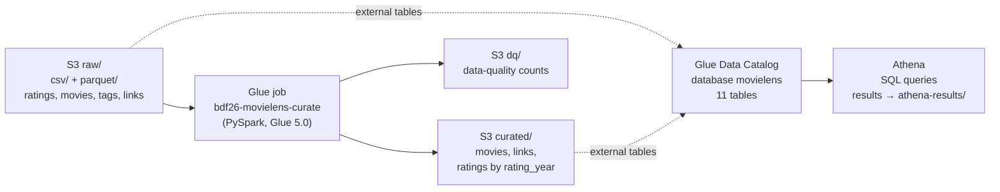

# AWS side — progress (Steps 0–4)

*Paulo · branch `paulo_aws` · last updated 24 Nov 2026*

The MovieLens 32M data now runs in AWS as well as locally ([full setup guide](AWS_SETUP_GUIDE.md)): raw files in S3, a Glue job that does the cleaning (Henrique's support tables), and Athena tables that return the same numbers as DuckDB. Every row count checked so far matches the local pipeline.

Account: AWS Academy Learner Lab `****6339`, region `us-east-1`, role `LabRole`. Bucket: `bdf26-movielens-6339`.

## What's built



The 11 Athena tables (all in database `movielens`):

| Table | Holds | Format |
|---|---|---|
| `ratings_csv` | the original ratings.csv (32,000,204 rows) | CSV |
| `movies_csv` | the original movies.csv (87,585 rows) | CSV |
| `tags_csv` | the original tags.csv (2,000,072 rows) | CSV |
| `links_csv` | the original links.csv (87,585 rows), IDs kept as text | CSV |
| `ratings_parquet` | ratings converted by `convert_csv_to_parquet.py` | Parquet |
| `movies_parquet` | movies, same conversion | Parquet |
| `tags_parquet` | tags, same conversion | Parquet |
| `links_parquet` | links, same conversion | Parquet |
| `ratings_curated` | cleaned ratings: rating kept as decimal, `dateOfRating`, **partitioned by `rating_year`** (29 years, 1995–2023) | Parquet |
| `movies_curated` | cleaned movies: title without the year, `yearOfRelease`, genres | Parquet |
| `links_curated` | links plus `imdb_tt` (`tt` + imdbId) for the Wilhelm join | Parquet |

Table definitions: [exports/glue_tables.json](exports/glue_tables.json). Bucket contents: [exports/s3_layout.txt](exports/s3_layout.txt).

## Results per step

| Step | What | Key result |
|---|---|---|
| 0 | Local pipeline | CSV → Parquet in 9.95 s; whole SQL file 7.3 s (main analysis query 5.4 s). Ryzen 5 laptop, DuckDB 2.0.0 |
| 1 | AWS access | Learner Lab works from the CLI; Glue, Athena and S3 reachable; naming convention fixed |
| 2 | S3 upload | 8 files, 1.1 GiB. Upload from home: CSV 49.6 s, Parquet 22.4 s (that measures home internet, not AWS) |
| 3 | Catalog raw tables | All 8 raw tables give the same row counts as DuckDB |
| 4 | Glue ETL job | Ran in **190 s, 381 DPU-seconds ≈ $0.047**. All curated counts, the average rating and the 29 per-year counts match DuckDB |

**Storage: CSV vs Parquet vs curated** (MB = 1024² bytes)

| Table | CSV | Parquet | Curated (Glue) |
|---|---:|---:|---:|
| ratings | 836.45 | 208.81 (4.0× smaller) | 90.38 (9.3× smaller) |
| tags | 69.00 | 20.21 | — (not used) |
| movies | 4.05 | 2.11 | 1.93 |
| links | 1.86 | 1.27 | 1.83 (extra `imdb_tt` column) |
| **total** | **911.35** | **232.41** | |

**Data Athena scanned for the same query** (`avg(rating)` over 32M ratings; Athena charges by data scanned)

| Table | Scanned | Runtime |
|---|---:|---:|
| `ratings_csv` | 836.5 MB | 2.5 s |
| `ratings_parquet` | 135.5 MB | 1.3 s |
| `ratings_curated` | **14.4 MB** | 1.3 s |

`count(*)` on any Parquet table scans 0 bytes, because the row count is in the file metadata; on CSV it reads the whole file. All numbers come from single runs; Step 6 will repeat them properly.

Data-quality counts from the Glue job ([results/dq_movielens_curate.csv](results/dq_movielens_curate.csv)): no null ratings, none outside 0.5–5.0, no duplicate (user, movie) pairs, no ratings for unknown movies, 615 movies without a release year, 124 links without a TMDB id. Rows per year: [results/rows_per_year.csv](results/rows_per_year.csv). Every Athena query I ran: [results/athena_query_log.csv](results/athena_query_log.csv).

## Findings for Henrique (local SQL)

Found while checking the cloud numbers against the local ones. Not changed in the local code; the Glue job already does it the corrected way.

1. **Rating cast to INTEGER.** `TRY_CAST(rating AS INTEGER)` changes 10,005,686 ratings (31.3%). DuckDB rounds half to even (2.5 → 2, 3.5 → 4), and 525,132 ratings of 0.5 become **0**, which is off the scale. The global average barely moves (3.5404 → 3.5347), but per-film averages are skewed. Suggest keeping it as DOUBLE or `DECIMAL(2,1)`.
2. **Title and year parsing.**
   - `LEFT(title, LENGTH(title) - 7)` also cuts titles that have no year: "Terrible Joe Moran" becomes "Terrible Jo". Titles with trailing spaces get cut unevenly.
   - The year comes from the last 5 characters, so titles that just end in digits get impossible years: "Irwin & Fran 2013" → **201**, "The Garden of Afflictions 2017" → **201**, "…Lingerie Calendar 2005-2006" → **−200**. One title with a doubled bracket, "(1983))", gets no year, and "(2006–2007)" gives 2007 instead of 2006.
   - Net effect: local finds 613 movies without a year, the Glue job 615. The Glue count is the right one: 613 + 3 bogus years − 1 missed year.
3. **Grouping by title instead of movieId.** 215 (title, year) groups cover 472 different films, so different films with the same title get their ratings merged.
4. **`requirements.txt` has no versions.** I got duckdb 2.0.0 and pandas 3.1.1; pinning them would make the local run reproducible.

## How to reproduce

**Without scripts:** [AWS_SETUP_GUIDE.md](AWS_SETUP_GUIDE.md) rebuilds everything by hand in the AWS console, step by step, and explains each piece. The commands below are the scripted way I did it.

You need **your own Learner Lab credentials** (each student's AWS account is separate). Start the lab and paste the AWS CLI block into `~/.aws/credentials` yourself. Never put it in the repo or in a chat. Use a bucket name with the last 4 digits of your own account ID, and replace `bdf26-movielens-6339` in the DDL files with it.

From the repo root, in PowerShell, after the local Parquet files exist (`python convert_csv_to_parquet.py`):

```powershell
.\aws\s3_upload.ps1 -Bucket <your-bucket>              # 1. bucket + raw/csv + raw/parquet
.\aws\athena_run.ps1 aws\athena\ddl\00_database.sql     # 2. database movielens
.\aws\athena_run.ps1 aws\athena\ddl\01_raw_csv.sql      # 3. raw CSV tables
.\aws\athena_run.ps1 aws\athena\ddl\02_raw_parquet.sql  # 4. raw Parquet tables
.\aws\athena_run.ps1 aws\athena\checks\01_row_counts.sql
.\aws\athena_run.ps1 aws\athena\checks\02_sanity.sql
.\aws\glue\run_job.ps1 -Bucket <your-bucket>            # 5. Glue job -> curated/ + dq/
.\aws\athena_run.ps1 aws\athena\ddl\03_curated.sql      # 6. curated tables + partitions
.\aws\athena_run.ps1 aws\athena\checks\03_curated_checks.sql -MaxRows 40
```

Add `-OutputLocation s3://<your-bucket>/athena-results/` to the `athena_run.ps1` calls if your bucket name differs. The Glue job's settings are in [exports/glue_job.json](exports/glue_job.json) and its run history in [exports/glue_job_runs.json](exports/glue_job_runs.json).

## Screenshots

To be added to `docs/aws/screenshots/`:

| File | Shows |
|---|---|
| `s3_bucket.png` | the bucket with `raw/`, `curated/` and `dq/` |
| `glue_job_run.png` | the successful run of `bdf26-movielens-curate` (duration, DPU) |
| `glue_tables.png` | the 11 tables in the `movielens` database |
| `athena_data_scanned.png` | the same query on CSV vs Parquet, with "Data scanned" visible |

<!-- Uncomment once the files are added:


-->

## Next steps

- **Step 5:** port Henrique's analysis queries (`movie_lens_analysis_queries.sql`) to Athena on the curated tables, and check every result against the local one.
- **Step 6:** performance comparison: the same queries on DuckDB (CSV, Parquet) and Athena (CSV, Parquet, partitioned Parquet), with runtime, data scanned and cost, repeated several times.
